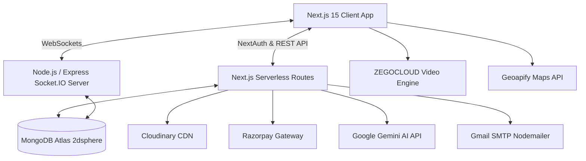

# 🚖 WHEELO — Smart On-Demand Vehicle Booking & Logistics Platform

<p align="center">
  
</p>

<p align="center">
  <b>A full-stack, real-time on-demand vehicle booking and transport ecosystem built with Next.js 15, TypeScript, Tailwind CSS, MongoDB, Socket.IO, and Google Gemini AI.</b>
</p>

<p align="center">
  
  
  
  
  
  
</p>

---

## 📌 Overview

**WHEELO** is a comprehensive multi-tier mobility platform designed to connect commuters and businesses with local vehicle operators (Bikes, Autos, Cars, Loading Trucks). It streamlines the complete lifecycle of rides: from geospatial discovery and dynamic pricing to secure OTP ride handshakes, online payment splitting, and real-time live vehicle tracking.

---

## ✨ Key Features

### 👤 1. Passenger / User Experience
* **Interactive Map & Location Search:** Powered by **Geoapify Geocoding API** for auto-complete pickup/drop locations.
* **Instant Fare Estimation:** Dynamic calculation considering base fare, rate per kilometer, and distance.
* **Flexible Payments:** Integrated **Razorpay** checkout for UPI/Cards/Netbanking + Cash on delivery support.
* **Secure OTP Verification:** Two-factor ride lifecycle (Pickup OTP to start journey, Drop OTP to safely complete and calculate driver share).
* **Live Ride Tracking:** Real-time driver location stream using Socket.IO room broadcast.
* **In-Ride Realtime Chat with AI Suggestions:** Real-time chat powered by Socket.IO with **Google Gemini AI Quick Replies** suggesting relevant, context-aware responses.

### 🚗 2. Driver / Partner Portal
* **Digital Onboarding & Verification:** Multi-step verification collecting Aadhar, Driving License, RC Book (uploaded securely to **Cloudinary**), and bank settlement details.
* **Live Video KYC:** Built-in peer-to-peer Video KYC room powered by **ZEGOCLOUD**.
* **Live Ride Dispatch:** Receive instant ride requests via WebSocket; accept or reject requests with automatic timeout deadlines.
* **Earnings Analytics:** Daily and 7-day revenue visualization with automatic 90% partner / 10% admin commission splitting.

### 🛡️ 3. Admin Control Center
* **Metrics Dashboard:** Real-time analytics of registered partners, vehicles, and active platform revenue.
* **Review & Verification Pipeline:** Manual verification and one-click approve/reject actions for pending partners and vehicle documents.
* **Financial Ledger:** Transparent commission collection tracking.

---

## 🏗️ Architecture & Tech Stack



* **Frontend:** Next.js 15 (App Router), React 19, TypeScript, Tailwind CSS, Framer Motion, Lucide Icons.
* **Backend:** Next.js Route Handlers + Standalone Express Socket.IO server.
* **Database:** MongoDB Atlas with Mongoose ODM (utilizing `2dsphere` geospatial indexing for `$near` queries).
* **Authentication:** NextAuth.js v5 (Auth.js) with Email OTP verification & Google OAuth 2.0.
* **Storage:** Cloudinary API for document & vehicle photo storage.
* **Payments:** Razorpay API (HMAC SHA-256 signature verification).
* **Video KYC:** ZEGOCLOUD Web RTC SDK.
* **AI Engine:** Google Gemini Flash API for conversational intelligence.

---

## 📁 Project Structure

```
Wheelo/
├── wheelo/                      # Main Next.js 15 Full-Stack Application
│   ├── src/
│   │   ├── app/                 # Next.js App Router (Pages & API endpoints)
│   │   │   ├── api/             # REST APIs (auth, booking, admin, partner, chat, payment)
│   │   │   ├── admin/           # Admin dashboard and review panels
│   │   │   ├── partner/         # Driver portal & ride management
│   │   │   ├── user/            # Passenger bookings & live ride screen
│   │   │   └── video-kyc/       # ZEGOCLOUD live KYC call screen
│   │   ├── components/          # Reusable UI & Business components
│   │   ├── models/              # Mongoose schemas (User, Vehicle, Booking, etc.)
│   │   ├── lib/                 # Database connection, Mailers, Cloudinary, Razorpay
│   │   └── auth.ts              # NextAuth configuration
│   └── public/                  # Static assets & brand logos
│
└── socketServer/                # Standalone WebSockets Server
    ├── models/                  # Shared models for socket context
    ├── index.js                 # Socket.IO connection and event dispatch logic
    └── package.json             # Socket server dependencies
```

---

## ⚙️ Environment Configuration

### Frontend & API (`wheelo/.env.local`):

```env
# Database
MONGODB_URL="mongodb+srv://<user>:<password>@cluster0.xxxxx.mongodb.net"

# Authentication
AUTH_SECRET="your-generated-secret"
AUTH_TRUST_HOST=true
NEXTAUTH_URL="http://localhost:3000"
AUTH_URL="http://localhost:3000"
AUTH_GOOGLE_ID="your-google-client-id"
AUTH_GOOGLE_SECRET="your-google-client-secret"

# Email SMTP
EMAIL="your-email@gmail.com"
PASS="your-gmail-app-password"

# Cloudinary
CLOUDINARY_CLOUD_NAME="your-cloud-name"
CLOUDINARY_API_KEY="your-api-key"
CLOUDINARY_API_SECRET="your-api-secret"

# ZEGOCLOUD Video KYC
NEXT_PUBLIC_ZEGO_APP_ID=your-zego-app-id
NEXT_PUBLIC_ZEGO_SERVER_SECRET="your-zego-server-secret"

# Geoapify Maps
NEXT_PUBLIC_GEOAPIFY_API_KEY="your-geoapify-key"

# Razorpay
RAZORPAY_KEY_ID="rzp_test_xxxx"
RAZORPAY_KEY_SECRET="your-razorpay-secret"
NEXT_PUBLIC_RAZORPAY_KEY_ID="rzp_test_xxxx"

# Google Gemini AI
GEMINI_API_URL="https://generativelanguage.googleapis.com/v1beta/models/gemini-2.5-flash:generateContent?key=your-key"

# Socket Server Endpoint
NEXT_PUBLIC_SOCKET_SERVER_URL="http://localhost:8000"
```

### Socket Server (`socketServer/.env`):

```env
PORT=8000
MONGODB_URL="mongodb+srv://<user>:<password>@cluster0.xxxxx.mongodb.net"
NEXT_BASE_URL="http://localhost:3000"
```

---

## 🛠️ Local Development Setup

### 1. Clone the repository
```bash
git clone https://github.com/hanwate-darshan/Wheelo_.git
cd Wheelo_
```

### 2. Run Main Next.js Application
```bash
cd wheelo
npm install
npm run dev
```
Application will run at `http://localhost:3000`.

### 3. Run Socket Server
```bash
cd socketServer
npm install
npm start
```
Socket server will listen on `http://localhost:8000`.

---

## 🧪 Testing & Validation

The codebase underwent automated module-by-module integration testing across all 8 modules (163 test cases covering Authentication, Geospatial indexing, OTP lifecycles, and Payment reconciliation):
```bash
npx tsc --noEmit  # 0 TypeScript compilation errors
```

---

## 📄 License
This project is licensed under the [MIT License](LICENSE).
